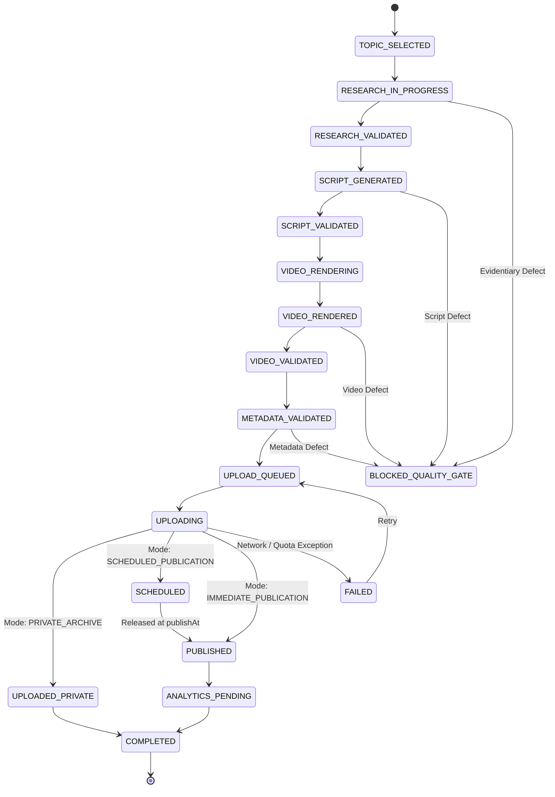

# Automated YouTube Publishing & Scheduling Standard

**Channel:** Stories Malik (`@StoriesMalik`)  
**Scope:** Phase 17 Autonomous Production Lifecycle, Automated Quality Gates, Upload Modes & Scheduling  
**Target Timezone:** India Standard Time (`Asia/Kolkata`, UTC+05:30)  
**Status:** Canonical & Enforced  

---

## 1. Core Principles

1. **Autonomous Execution:** Manual human approval is no longer a blocking dependency. Publication eligibility is governed strictly by verifiable automated quality gates.
2. **Automated Quality Gates:** Before any video reaches YouTube, automated gates independently validate Research evidence, Script pacing and duration, Video file integrity, and Metadata parameters.
3. **Deterministic 18-Stage Lifecycle:** Assets progress through an immutable state machine from `TOPIC_SELECTED` to `COMPLETED`. Any quality failure halts progression and transitions to `BLOCKED_QUALITY_GATE` with a diagnostic report.
4. **Idempotency & Duplicate Prevention:** Every production job maintains a persistent record. Uploads verify that a video has not already been scheduled or published, preventing duplicate public uploads and wasted API quota.
5. **Private-by-Default Security:** Production uploads use `SCHEDULED_PUBLICATION` mode by default, uploading with `privacyStatus: "private"` and future `publishAt` timestamps.

---

## 2. The 18-State Production Lifecycle

### State Definitions

| State | Description | Permitted Next States |
|---|---|---|
| `TOPIC_SELECTED` | Topic chosen from 10 content pillars | `RESEARCH_IN_PROGRESS`, `BLOCKED_QUALITY_GATE`, `FAILED` |
| `RESEARCH_IN_PROGRESS` | Multi-tier historical evidence acquisition active | `RESEARCH_VALIDATED`, `BLOCKED_QUALITY_GATE`, `FAILED` |
| `RESEARCH_VALIDATED` | Passed research quality gate | `SCRIPT_GENERATED`, `BLOCKED_QUALITY_GATE`, `FAILED` |
| `SCRIPT_GENERATED` | Narration, sections, and hooks generated | `SCRIPT_VALIDATED`, `BLOCKED_QUALITY_GATE`, `FAILED` |
| `SCRIPT_VALIDATED` | Passed script quality gate | `VIDEO_RENDERING`, `BLOCKED_QUALITY_GATE`, `FAILED` |
| `VIDEO_RENDERING` | Voiceover, video clips, and subtitles assembling | `VIDEO_RENDERED`, `FAILED` |
| `VIDEO_RENDERED` | Physical MP4 rendered on disk | `VIDEO_VALIDATED`, `METADATA_VALIDATED`, `BLOCKED_QUALITY_GATE`, `FAILED` |
| `VIDEO_VALIDATED` | Passed video integrity and duration gate | `METADATA_VALIDATED`, `UPLOAD_QUEUED`, `BLOCKED_QUALITY_GATE`, `FAILED` |
| `METADATA_VALIDATED` | Passed SEO and compliance metadata gate | `UPLOAD_QUEUED`, `UPLOADING`, `BLOCKED_QUALITY_GATE`, `FAILED` |
| `UPLOAD_QUEUED` | Ready for upload execution | `UPLOADING`, `FAILED` |
| `UPLOADING` | Active resumable upload stream to YouTube | `UPLOADED_PRIVATE`, `SCHEDULED`, `PUBLISHED`, `FAILED` |
| `UPLOADED_PRIVATE` | Uploaded in private archive mode | `SCHEDULED`, `PUBLISHED`, `ANALYTICS_PENDING`, `COMPLETED`, `FAILED` |
| `SCHEDULED` | Uploaded as private with future `publishAt` timestamp | `PUBLISHED`, `ANALYTICS_PENDING`, `COMPLETED`, `FAILED` |
| `PUBLISHED` | Publicly live on YouTube | `ANALYTICS_PENDING`, `COMPLETED`, `FAILED` |
| `ANALYTICS_PENDING` | Queued for 24h, 48h, 7d, 28d performance snapshots | `COMPLETED`, `ANALYTICS_PENDING`, `FAILED` |
| `COMPLETED` | Final lifecycle completion | `ANALYTICS_PENDING` |
| `FAILED` | Recoverable technical error (quota, network) | `TOPIC_SELECTED`, `VIDEO_RENDERING`, `UPLOAD_QUEUED` |
| `BLOCKED_QUALITY_GATE` | Non-recoverable quality failure with diagnostic report | `TOPIC_SELECTED`, `SCRIPT_GENERATED`, `FAILED` |

---

## 3. Four Automated Quality Gates

Every video must pass all 4 quality gates implemented in `uploader/quality_gates.py`:

### 1. Research Quality Gate (`validate_research_gate`)
- Defined topic, historical period, and geographic location.
- Minimum 3 claims backed by verified evidence levels (`ESTABLISHED_FACT`, `STRONGLY_SUPPORTED`, `DISPUTED_INTERPRETATION`).
- Less than 50% speculative claims.
- Minimum 2 chronological timeline milestones.
- Confidence score $\ge 0.65$.

### 2. Script Quality Gate (`validate_script_gate`)
- Long-form: 4 to 12 sections; 350 to 2,400 words (duration strictly $< 15$ min).
- Shorts: 2 to 6 sections; 40 to 220 words (duration 25s to 60s).
- Zero unrendered placeholder tokens (`[INSERT]`, `lorem ipsum`, `undefined`, `null`).
- Zero duplicate or repetitive adjacent narrations.

### 3. Video Quality Gate (`validate_video_gate`)
- Physical MP4 exists on filesystem.
- File size healthy ($> 150\text{ KB}$ for Shorts, $> 500\text{ KB}$ for long-form).
- Thumbnail exists, valid JPEG format, size between $5\text{ KB}$ and $2\text{ MB}$.

### 4. Metadata Quality Gate (`validate_metadata_gate`)
- Title: 5 to 100 characters, no sensationalist keyword stuffing.
- Description: 20 to 5,000 characters with genuine historical context.
- Tags: at least 3 relevant tags, total characters $\le 480$.
- Category ID: verified numeric string (e.g., `27` for Education).
- Default Language: configured as `"hi"`.

---

## 4. Supported Upload Modes

Configured via `config.YOUTUBE_UPLOAD_MODE` or environment variable `YOUTUBE_UPLOAD_MODE`:

### 1. `SCHEDULED_PUBLICATION` (Default Production Mode)
- `status.privacyStatus = "private"`
- `status.publishAt = <future ISO 8601 UTC timestamp>`
- Automatically calculates optimal target slots in `Asia/Kolkata`:
  - **Long-form:** 19:00 IST (7:00 PM)
  - **Shorts:** 10:00 AM IST and 18:00 IST (6:00 PM)
- YouTube automatically promotes the video to Public when the release timestamp arrives.

### 2. `IMMEDIATE_PUBLICATION`
- `status.privacyStatus = "public"`
- No `publishAt` parameter. Video becomes public immediately upon upload processing.

### 3. `PRIVATE_ARCHIVE`
- `status.privacyStatus = "private"`
- No `publishAt` parameter. Video remains private for internal archival.

---

## 5. Technical Upload Parameters

Uploaded via official YouTube Data API v3 `videos.insert`:
- `snippet.title`: Up to 100 characters.
- `snippet.description`: Up to 5,000 characters.
- `snippet.tags`: Up to 15 targeted tags.
- `snippet.categoryId`: Verified regional category ID.
- `snippet.defaultLanguage`: `"hi"`.
- `status.privacyStatus`: Set per upload mode.
- `status.publishAt`: RFC 3339 UTC string when scheduled.
- `status.license`: `"youtube"`.
- `status.embeddable`: `True`.
- `status.publicStatsViewable`: `True`.
- `status.selfDeclaredMadeForKids`: `False`.
- `status.containsSyntheticMedia`: `True` (Mandatory YouTube AI disclosure).
- `notifySubscribers`: `True` for long-form, `False` for Shorts (to prevent feed fatigue).
- Resumable chunk size: `5 * 1024 * 1024` bytes (5 MB chunks).

---

## 6. Post-Upload Processing Verification

After `videos.insert` returns a video ID:
1. Queries `youtube.videos().list(id=video_id, part="snippet,status,processingDetails")`.
2. Inspects `uploadStatus`, `processingStatus` (`processing`, `succeeded`), and `rejectionReason`.
3. Verifies that the scheduled publication timestamp matches the target IST slot.
4. Transitions state to `SCHEDULED` or `PUBLISHED`.
5. Queues `PublishingState.ANALYTICS_PENDING` for ongoing retention tracking.
