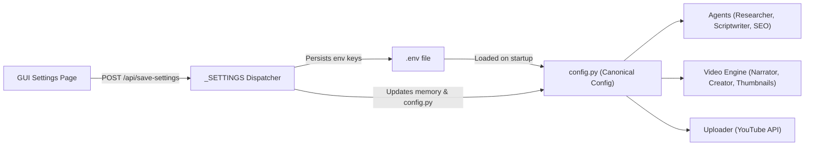

# Channel Identity and Configuration Standard
**YouTube Agentic AI Studio (YAAS)**  
**Channel:** Stories Malik  
**Canonical Specification Reference:** `docs/CHANNEL_CONFIGURATION.md`  

---

## 1. Overview & Single Source of Truth

To ensure consistency across the GUI, CLI, automation daemons, CI pipelines, and video rendering engines, all channel metadata and brand identity settings are unified in `config.py`.

The system supports environment-based overrides via `.env` while maintaining sane, production-ready defaults in `config.py`. Changes made via the GUI Settings tab (`/api/save-settings`) seamlessly synchronize with both `.env` and `config.py`.

---

## 2. Canonical Brand Specifications

| Configuration Parameter | Variable Name | Default Value | Description |
| :--- | :--- | :--- | :--- |
| **Channel Brand Name** | `CHANNEL_NAME` | `Stories Malik` | Canonical channel title used in titles, descriptions, on-video tags, and upload manifests. |
| **On-Video Brand Tag** | `BRAND_TEXT` | `""` (falls back to `CHANNEL_NAME`) | Text shown on-screen in the hook card and on Shorts. |
| **Show On-Video Brand** | `SHOW_CHANNEL_BRAND` | `True` | Flag toggling the `▶ BRAND_NAME` overlay on video clips. |
| **Primary Language** | `DEFAULT_LANGUAGE` | `hi` (Hindi) | Broadcast-quality Hindi in Devanagari script for narration and primary on-screen text. |
| **Secondary Language** | `SECONDARY_LANGUAGE` | `en` (English) | English translation for international subtitles and stock media image search queries. |
| **Target Audience** | `TARGET_AUDIENCE` | Hindi-speaking viewers in India & diaspora | Enthusiasts of ancient civilizations, Indian history, military strategy, and archaeological discoveries. |
| **Content Niche** | `CONTENT_CATEGORY` | History & Archaeology | Cinematic documentaries, ancient empires, lost cities, and evidence-based historical mysteries. |
| **Publishing Timezone** | `PUBLISHING_TIMEZONE` | `Asia/Kolkata` (IST, UTC+5:30) | Reference timezone for all release scheduling and audience peak timing calculations. |
| **Long-Form Target Duration** | `VIDEO_MIN_MINUTES` / `VIDEO_MAX_MINUTES` | `8` to `13` minutes | Target narration length (950–1,250 words; strict hard cap under 14:30). |
| **Shorts Target Duration** | `SHORTS_MIN_SECONDS` / `SHORTS_MAX_SECONDS` | `25` to `60` seconds | Fast-paced vertical (9:16) historical insight with clear payoff. |
| **Primary Hindi Voice** | `VOICE_ID` | `hi-IN-MadhurNeural` | Deep, resonant, authoritative male voiceover tailored for documentary gravity. |
| **Secondary English Voice** | `VOICE_ID_EN` | `en-US-AndrewNeural` | Clear, measured documentary voice for auto-dubbed versions. |
| **Video Resolution** | `VIDEO_RESOLUTION` | `2k` (2560×1440) | 1440p QHD: triggers YouTube's high-bitrate VP09/AV01 codec allocation. |

---

## 3. Configuration Precedence & Synchronization

Settings are resolved in the following deterministic order of precedence:
1. **Runtime Arguments / Overrides:** Function-level parameters (e.g., `upload_to_youtube(title=...)`, `write_script(language="en")`).
2. **Environment Variables (`.env`):** Loaded on application startup via `_load_env()`.
3. **Canonical Defaults (`config.py`):** System constants defined in `config.py`.

### Safe Synchronization Flow

---

## 4. Stale Branding Prevention

All generated titles, descriptions, calls to action (CTAs), thumbnail overlays, and video watermarks MUST reference `config.CHANNEL_NAME` dynamically. 

### Forbidden Stale Terms
Under no circumstances should the following legacy or placeholder terms appear in generated video metadata:
* `"History Chronicles"`
* `"My AI Channel"`
* `"Raunak Patil"` / `"raunakpatil.com"`
* `"Science and Technology Studio"`

Automated tests in `tests/test_channel_config.py` enforce these constraints on every test execution.
