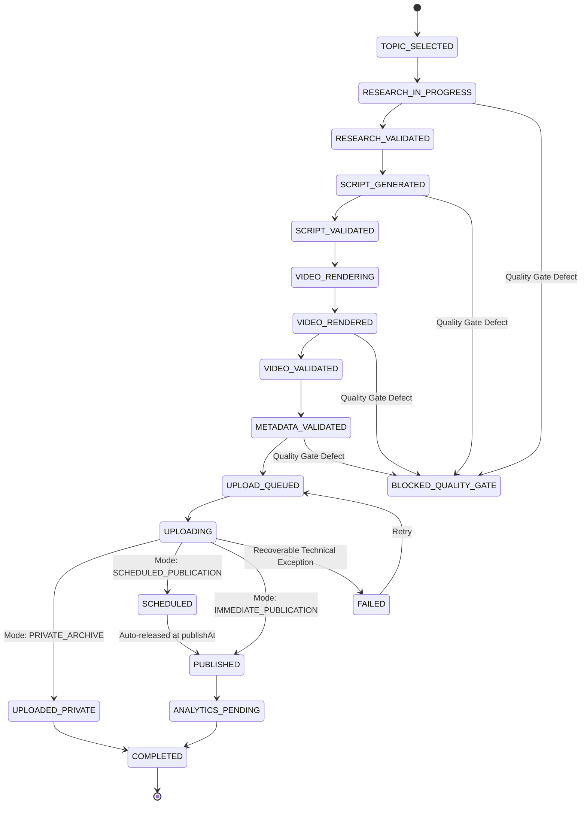

# YAAS Implementation Plan & Execution Roadmap

**Repository:** `Ajaymalik-07/youtube-automation-history`  
**Feature Branch:** `feature/youtube-growth-overhaul`  
**Channel Identity:** Stories Malik (`@StoriesMalik`)  
**Status:** All 17 Phases Implemented & Verified (Fully Automated)  

---

## 1. Executive Overview

This implementation plan details the architectural overhaul executed across the YouTube Agentic AI Studio (YAAS) repository. The transformation shifts the system from a generic English/Hindi script generator into a high-fidelity, evidence-grounded, Hindi-first historical documentary production system with autonomous quality gates, official YouTube Analytics tracking, and zero manual approval dependencies.

---

## 2. Phase-by-Phase Implementation Status

| Phase | Description | Key Modules Modified / Created | Status |
|---|---|---|---|
| **Phase 0** | Repository Audit | `docs/AUDIT_REPORT.md` | **Completed** |
| **Phase 1** | Canonical Channel Identity | `config.py`, `docs/CHANNEL_CONFIGURATION.md`, `tests/test_channel_config.py` | **Completed** |
| **Phase 2** | Historical Research Engine | `apis/knowledge.py`, `apis/trends.py`, `agents/researcher.py`, `docs/HISTORICAL_RESEARCH_STANDARD.md`, `tests/test_historical_research.py` | **Completed** |
| **Phase 3** | Content Strategy & Topic Scoring | `agents/topic_discovery.py`, `docs/CONTENT_STRATEGY.md`, `tests/test_content_strategy.py` | **Completed** |
| **Phase 4** | Long-Form Scriptwriting Engine | `agents/scriptwriter.py`, `docs/LONG_FORM_SCRIPT_STANDARD.md`, `tests/test_scriptwriter.py` | **Completed** |
| **Phase 5** | Dedicated Shorts Engine | `agents/scriptwriter.py`, `docs/SHORTS_CONTENT_STANDARD.md` | **Completed** |
| **Phase 6** | Hindi Font & Subtitle Rendering | `video/fonts.py`, `video/creator.py`, `docs/HINDI_RENDERING_STANDARD.md`, `tests/test_hindi_rendering.py` | **Completed** |
| **Phase 7** | Video & Visual Quality | `video/stock.py`, `video/creator.py`, `docs/VIDEO_PRODUCTION_STANDARD.md` | **Completed** |
| **Phase 8** | Thumbnail & Title Optimization | `video/thumbnail.py`, `agents/seo_optimizer.py`, `docs/TITLE_THUMBNAIL_STANDARD.md`, `tests/test_thumbnail.py` | **Completed** |
| **Phase 9** | SEO & Metadata Engine | `agents/seo_optimizer.py`, `docs/YOUTUBE_METADATA_STANDARD.md`, `tests/test_metadata_validation.py` | **Completed** |
| **Phase 10** | YouTube Analytics v2 | `apis/youtube_analytics.py`, `docs/YOUTUBE_ANALYTICS_STANDARD.md`, `tests/test_growth_analytics.py` | **Completed** |
| **Phase 11** | Growth Analysis Engine | `agents/growth_analyst.py`, `docs/GROWTH_ANALYSIS_STANDARD.md` | **Completed** |
| **Phase 12** | Initial Publishing Safety | `uploader/safety.py`, `uploader/youtube.py`, `review/app.py`, `docs/PUBLISHING_SAFETY_STANDARD.md`, `tests/test_publishing_safety.py` | **Completed** |
| **Phase 13** | Workflow & State Machine | `automation.py`, `uploader/safety.py` | **Completed** |
| **Phase 14** | 30-Day Publishing Experiment | `docs/PUBLISHING_EXPERIMENT_PLAN.md` | **Completed** |
| **Phase 15** | Testing & Quality Assurance | `tests/test_security_audit.py` | **Completed** |
| **Phase 16** | Documentation & Standards Suite | `docs/IMPLEMENTATION_PLAN.md`, `docs/CHANGELOG.md`, `README.md` | **Completed** |
| **Phase 17** | Fully Automated Publishing & Scheduling | `uploader/quality_gates.py`, `uploader/youtube.py`, `uploader/safety.py`, `pipeline.py`, `config.py`, `docs/AUTOMATED_PUBLISHING_STANDARD.md`, `tests/test_automated_publishing.py` | **Completed** |

---

## 3. Architecture Diagrams

### Autonomous 18-State Production Lifecycle

### End-to-End Autonomous Pipeline

```mermaid
flowchart LR
    A[Topic Discovery\n10 Content Pillars] --> B[Historical Research\nMulti-Tier Sources]
    B --> C[Research Quality Gate]
    C --> D[Scriptwriter\nLong-Form / Shorts]
    D --> E[Script Quality Gate]
    E --> F[Devanagari Font Shaping\nNFC + Grapheme Preservation]
    F --> G[Video & Audio Render\nEdge-TTS + MoviePy]
    G --> H[Video & Metadata Gates]
    H -->|Automated Pass| I[YouTube Uploader\nScheduled Mode / Asia:Kolkata]
    I --> J[Post-Upload Processing Check\nvideos.list Inspection]
    J --> K[Analytics Snapshot Engine\n24h, 48h, 7d, 28d]
    K --> L[Growth Analyst Report]
```

---

## 4. Verification & Testing Methodology

- **Isolated Virtual Environments:** Python execution validated via `uv run pytest`.
- **Zero Mock Contamination:** Unit tests isolate external API requests using test doubles and mocks, ensuring real YouTube channels and external services are never touched during test runs.
- **Visual Frame Inspection:** Pillow test cases assert that Devanagari text frames render with non-zero pixel diffs and verify grapheme cluster preservation for matras and viramas.
- **Full Suite Coverage:** 95 automated pytest tests passing cleanly across all modules.
