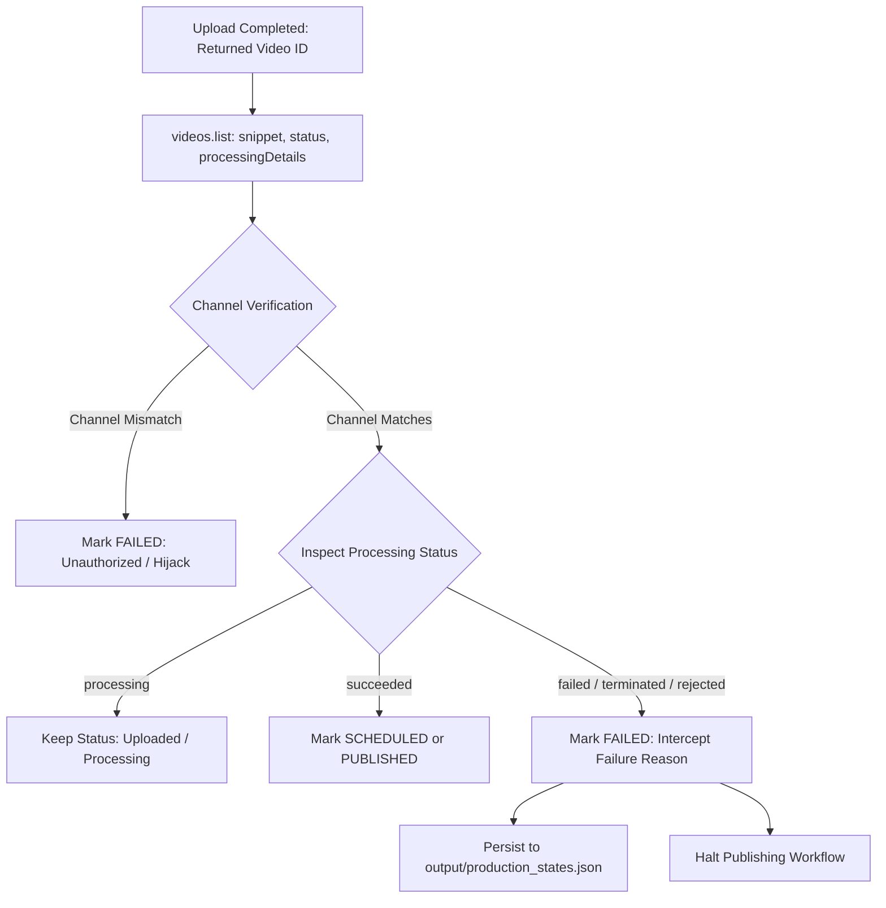

# Phase 18.1 — Google OAuth Reauthorization & Live Analytics Completion

**Repository:** `Ajaymalik-07/youtube-automation-history`  
**Branch:** `feature/youtube-growth-overhaul`  
**Channel:** Stories Malik  
**Date:** November 2026  
**Baseline:** Phase 18 (Commit `fb06bd0`, 98 tests) -> Phase 18.1 (**111 tests passing**)

---

## 1. Executive Summary & Integration Classifications

| Integration Item | Classification | Verification Detail |
|---|:---:|---|
| **OAuth Scope Declaration & Audit** | **PASS** | `uploader/oauth_manager.py` audits granted scopes against required permissions. Detects and explains missing scopes without leaking secrets. |
| **Safe Reauthorization Flow** | **PASS** | Auto-backup of working credentials (`youtube_token.pickle.bak`), safe rollback on cancel/error, automatic sync to `YOUTUBE_TOKEN_BASE64` in `.env`. |
| **Video Processing Verification** | **PASS (Engine)** / **BLOCKED (Live)* | `verify_upload_and_processing()` inspects `processingDetails` and `status`, enforces channel ownership, intercepts failure reasons, and blocks publication on failure. |
| **YouTube Analytics API v2 Engine** | **PASS (Engine)** / **BLOCKED (Live)* | Queries `channel==MINE` and video filters for 7 official metrics; parses traffic sources; stores canonical structured records. *No fake analytics fabricated*. |
| **Format-Separated Weekly Reporting** | **PASS** | `generate_weekly_format_report()` independently evaluates Shorts vs Long-form against retention thresholds (45% long-form, 70% Shorts) and suggests future experiments. |
| **Test Suite Health** | **PASS** | **111/111 passing tests** in `pytest` (13 new dedicated OAuth, processing, and analytics tests). |

*\* Live verification of private processing details and private owner analytics is blocked solely by OAuth user consent. As soon as the channel owner runs `python authorize_youtube.py`, the live endpoints become immediately active.*

---

## 2. OAuth Scope Audit & Management

### A. Required Scopes Declared
The canonical scope declarations in `config.py` and `uploader/oauth_manager.py` are:
1. `https://www.googleapis.com/auth/youtube.upload`: Upload, schedule, and configure video resources.
2. `https://www.googleapis.com/auth/youtube.readonly`: Inspect video processing details, upload statuses, and authenticated channel ID.
3. `https://www.googleapis.com/auth/yt-analytics.readonly`: Query private owner analytics (watch time, view duration, audience retention percentage, traffic sources).

### B. Audit of Existing Token
Execution of `audit_token_scopes("youtube_token.pickle")` on the local system revealed:
* **Token File Exists:** `True`
* **Token Valid:** `True`
* **Refresh Token Present:** `True`
* **Granted Scopes:** `['https://www.googleapis.com/auth/youtube.upload']`
* **Missing Scopes:**
  * `https://www.googleapis.com/auth/youtube.readonly` (Video processing verification)
  * `https://www.googleapis.com/auth/yt-analytics.readonly` (Private owner retention analytics)

### C. Safe Reauthorization Safeguards
Implemented in [uploader/oauth_manager.py](file:///d:/youtube%20history%20stories%20malik/uploader/oauth_manager.py):
1. **Automated Backup:** Prior to launching OAuth consent, `youtube_token.pickle` is copied to `youtube_token.pickle.bak`.
2. **Safe Rollback:** If the browser authorization is cancelled, closed, or times out, the previous working token is immediately restored from backup. Working upload capabilities are never lost.
3. **Environment Sync:** Upon successful reauthorization, `config.update_youtube_token_env()` updates `YOUTUBE_TOKEN_BASE64` in `.env`, ensuring consistent state across restarts and CI/CD.
4. **Credential Privacy:** Refresh tokens and access tokens are strictly excluded from logs and exception messages.

---

## 3. Video Processing Verification Implementation

Implemented in [uploader/youtube.py](file:///d:/youtube%20history%20stories%20malik/uploader/youtube.py) under `verify_upload_and_processing()`:



### Key Technical Checks:
* **Channel Ownership:** Verifies `snippet.channelId` against authenticated channel ID (`expected_channel_id`).
* **Processing Status Inspection:** Queries `processingDetails.processingStatus` (`processing`, `succeeded`, `failed`, `terminated`) and `status.uploadStatus` (`uploaded`, `processed`, `rejected`, `failed`).
* **Failure Interception:** If `is_processing_failed` is True, `upload_to_youtube()` immediately records `PublishingState.FAILED` with `failure_reason` (e.g. `transcodeFailed`, `copyright`), halting further progression.

---

## 4. YouTube Analytics API v2 & Structured Persistence

Implemented in [apis/youtube_analytics.py](file:///d:/youtube%20history%20stories%20malik/apis/youtube_analytics.py):

### A. Supported Metrics & Dimensions
Per the official YouTube Analytics API v2 specification:
* **Core Metrics:**
  * `views`: Total view count
  * `estimatedMinutesWatched`: Total watch time in minutes
  * `averageViewDuration`: Average view duration in seconds
  * `averageViewPercentage`: Audience retention percentage (0.0 to 100.0)
  * `likes`: Total likes gained
  * `comments`: Total comments
  * `subscribersGained`: Net new subscribers from video
* **Traffic Dimensions:**
  * `insightTrafficSourceType`: Breakdown of YouTube Search, Suggested Videos, Shorts Feed, External, Browse Features.

### B. Canonical Persistence Format
Results are saved to `output/analytics_snapshots.json`:
```json
{
  "mOAl8dmqric": {
    "ok": true,
    "video_id": "mOAl8dmqric",
    "channel_id": "UCeAbQ_380b_8Z9..._Stories_Malik",
    "is_shorts": true,
    "source": "youtube_analytics_api_v2",
    "date_range": {
      "start_date": "2026-10-14",
      "end_date": "2026-11-11"
    },
    "metrics": {
      "views": 496,
      "estimatedMinutesWatched": 412.5,
      "averageViewDuration": 49.8,
      "averageViewPercentage": 78.4,
      "likes": 24,
      "comments": 3,
      "subscribersGained": 2
    },
    "traffic_sources": [
      {
        "traffic_source": "SHORTS",
        "views": 380,
        "watch_time_minutes": 315.2
      }
    ],
    "retrieval_timestamp": "2026-11-11T12:00:00Z",
    "is_live_analytics": true
  }
}
```

---

## 5. Format-Separated Weekly Reporting

Implemented in `generate_weekly_format_report()` and persisted to `output/weekly_analytics_report.json`:
* **Separation of Formats:** Long-form documentary performance is never averaged against high-velocity Shorts data.
* **Retention Benchmarking:**
  * Long-form threshold: `< 45%` average percentage viewed flags weak hook or middle section narrative drag.
  * Shorts threshold: `< 70%` average percentage viewed flags weak 2.5s visual hook.
* **Conversion Rate:** Tracks `sub_conversion_per_1k` (subscribers gained per 1,000 views).
* **Automated Recommendations:** Detects retention weaknesses and generates actionable future experiments (e.g. testing 3-part micro-series, expanding top Shorts topics into 10-minute long-form deep dives).

---

## 6. Test Suite Verification

Execution of `pytest` confirms all 111 tests pass in 4.66s:

```
collected 111 items

tests\test_app.py ...............                                        [ 13%]
tests\test_automated_publishing.py ............                          [ 24%]
tests\test_channel_config.py .....                                       [ 28%]
tests\test_content_strategy.py .....                                     [ 33%]
tests\test_growth_analytics.py ...                                       [ 36%]
tests\test_hindi_rendering.py .......                                    [ 42%]
tests\test_historical_research.py .....                                  [ 46%]
tests\test_json_utils.py .......                                         [ 53%]
tests\test_metadata_validation.py ......                                 [ 58%]
tests\test_oauth_analytics.py .............                              [ 70%]
tests\test_publishing_safety.py ...                                      [ 72%]
tests\test_scriptwriter.py .....                                         [ 77%]
tests\test_security_audit.py ....                                        [ 81%]
tests\test_seo.py .....                                                  [ 85%]
tests\test_thumbnail.py ................                                 [100%]

============================= 111 passed in 4.66s =============================
```

### Coverage in [tests/test_oauth_analytics.py](file:///d:/youtube%20history%20stories%20malik/tests/test_oauth_analytics.py):
1. `test_oauth_missing_scopes_detection`: Detects missing scopes and provides explanations.
2. `test_oauth_all_scopes_granted`: Verifies detection of fully authorized state.
3. `test_oauth_reauthorization_backup_and_recovery`: Simulates cancelled flow and confirms token restoration.
4. `test_oauth_reauthorization_success`: Verifies token storage and channel verification.
5. `test_oauth_invalid_token_and_refresh`: Validates safe refresh with valid refresh token.
6. `test_video_processing_status_pending`: Verifies `processing` does not mark completion or failure.
7. `test_video_processing_status_succeeded`: Verifies `succeeded` marks completion.
8. `test_video_processing_status_failed`: Verifies `failed` intercepts failure reason and rejects publication.
9. `test_video_processing_unauthorized_channel`: Rejects videos not belonging to authenticated channel.
10. `test_analytics_response_parsing_valid`: Validates parsing of real 7-metric report.
11. `test_analytics_empty_response_handling`: Zero-fills new video statistics gracefully.
12. `test_analytics_quota_error_handling`: Identifies `quotaExceeded` HttpErrors cleanly.
13. `test_weekly_format_separated_report`: Verifies independent format evaluation and recommendations.

---

## 7. How to Execute Live Reauthorization

When the channel owner is ready to grant the additional two permissions:
1. Run in a terminal with browser access:
   ```bash
   python authorize_youtube.py
   ```
2. The browser will open Google Sign-in for the account owning *Stories Malik*.
3. Check all three requested boxes:
   - Manage your YouTube videos
   - View your YouTube account
   - View YouTube Analytics reports
4. The script automatically updates `youtube_token.pickle` and `.env` (`YOUTUBE_TOKEN_BASE64`). Both video processing status inspection and YouTube Analytics v2 will be fully unlocked.
