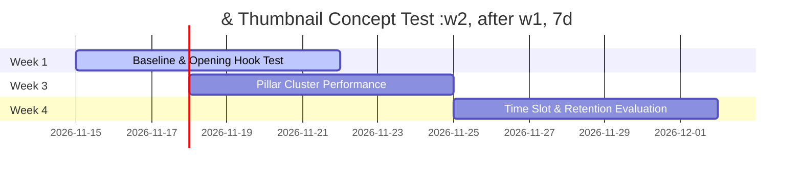

# 30-Day Controlled Publishing Experiment Plan

**Channel:** Stories Malik (`@StoriesMalik`)  
**Target Market:** Hindi-speaking audience (India & Diaspora)  
**Primary Timezone:** India Standard Time (`Asia/Kolkata`, UTC+5:30)  
**Status:** Active Protocol (Amended by Phase 21 — Publishing Cadence Preservation)  

---

## 1. Executive Summary & Philosophy

Stories Malik operates a deterministic, hypothesis-driven 30-day rolling evaluation regimen while **preserving the channel's established daily publishing cadence** (1 Long-form + 5 YouTube Shorts = 6 videos daily in `Asia/Kolkata`). High-retention documentary storytelling requires craft, rigorous evidence verification, and polished Devanagari typography.

**Primary Goal:** Establish rolling 30-day baseline viewership and retention benchmarks across formats, identify highest-performing historical pillars, and validate single-variable creative/packaging experiments without automatically reducing or altering publishing frequency.

---

## 2. Established Daily Release Schedule (IST / Asia/Kolkata — Preserved Default)

### Long-Form Documentaries (8–13 minutes)
- **Frequency:** **1 video daily** (7 episodes per week — preserved default; never reduced to 2–3/week without documented statistical evidence).
- **Primary Release Slot:** **19:00 IST (7:00 PM)** — Prime evening digital viewing window across North and Central India.

### Dedicated YouTube Shorts (25–60 seconds)
- **Frequency:** **5 Shorts daily** (35 Shorts per week — preserved default; never reduced to 1–2/day without documented statistical evidence).
- **Target Release Slots (IST):** **09:00, 12:00, 16:00, 19:00, and 22:00 IST** (configurable via `config.SHORTS_TARGET_HOURS_IST` and `output/automation_schedule.json`).
- **Format Distribution:** Rotated across the 8 canonical Shorts documentary formats (Archaeological Discoveries, Forgotten Personalities, Ancient Engineering & Architecture, Myth vs Fact, Battle Strategy, Historical Mystery, Historical Fact, Documentary Teaser).

> [!IMPORTANT]
> **Phase 21 Adaptive Publishing Policy:** Publishing frequency is treated strictly as a controlled experimental variable, not an automatic optimization target. Any future frequency experiment must document a hypothesis, change only one major variable at a time, define measurable success criteria, preserve a baseline comparison, and never silently mutate the production schedule.

---

## 3. Four-Week Controlled Experiment Matrix

### Week 1: Baseline Establishment & Hook Variation
- **Long-form Topic 1:** *The Forgotten Fortress of Kalinjar: Unconquered Bastion of Bundelkhand*
- **Long-form Topic 2:** *Harappan Drainage & Metallurgy: Bronze Age Civil Engineering*
- **Variable Under Test:** Opening Hook Formula (Question/Paradox Hook vs In-Media-Res Archaeological Discovery).
- **Hypothesis:** Historical mysteries opened with tangible physical artifacts retain 20% higher 30-second viewer retention than abstract theoretical questions.

### Week 2: Thumbnail & Title Strategy Testing
- **Long-form Topic 3:** *Chola Naval Expeditions to Southeast Asia: Tamil Maritime Empire*
- **Long-form Topic 4:** *Raja Bhoj of Dhar: Polymath King and Ancient Hydraulic Systems*
- **Variable Under Test:** 3-Way Title Candidate Testing (Search-focused vs Story-focused vs Curiosity-focused).
- **Hypothesis:** Devanagari Hindi-first titles with clear historical stakes yield higher CTR than generic sensationalist hooks.

### Week 3: Content Pillar Comparison
- **Long-form Topic 5:** *Lost River Saraswati: Paleochannel Geological Evidence & Ancient Texts*
- **Long-form Topic 6:** *The Metallurgy of the Delhi Iron Pillar: Corrosion Resistance Explained*
- **Variable Under Test:** Ancient Civilizations (Pillar 1) vs Ancient Engineering (Pillar 5).
- **Hypothesis:** Ancient engineering and tangible architectural feats drive higher average watch percentage and comment engagement than broad dynastic chronologies.

### Week 4: Publishing Window & Retention Optimization
- **Long-form Topic 7:** *Taxila University: How Ancient Scholars Cured Diseases & Debated Philosophy*
- **Long-form Topic 8:** *The Defense Tactics of Maharana Pratap at Haldighati*
- **Variable Under Test:** 19:00 IST vs 20:30 IST release time.
- **Hypothesis:** 19:00 IST allows immediate notification surge before the prime 20:00–22:00 YouTube viewer peak.

---

## 4. Key Performance Indicators & Analytics Checkpoints

Performance is measured at structured intervals via `apis/youtube_analytics.py`:
- **Snapshot T+24h:** Initial velocity, impressions CTR, subscriber conversion rate.
- **Snapshot T+48h:** Browse feature vs Suggested video traffic distribution.
- **Snapshot T+7d:** Stabilized Average Percentage Viewed (APV) and search indexation.
- **Snapshot T+28d:** Long-tail traffic and evergreen catalog momentum.

### Target Benchmarks

| Metric | Long-Form Target (8–13 min) | Shorts Target (30–55s) |
|---|---|---|
| **Impressions CTR** | 6.5% – 11.0% | N/A (Feed-driven) |
| **First 30s Retention** | $\ge 65\%$ | $\ge 75\%$ (First 5s) |
| **Average Percentage Viewed (APV)** | $\ge 42\%$ | $\ge 82\%$ |
| **Viewed vs Swiped Away** | N/A | $\ge 70\%$ Viewed |
| **Subscriber Conversion** | $\ge 1.2$ subs / 1k views | $\ge 2.5$ subs / 1k views |

---

## 5. Quality Circuit Breaker

If any of the following occur during the 30-day experiment:
1. Long-form APV drops below 35% on two consecutive videos:
   - **Action:** Halt release increase. Re-evaluate script transitions, narration pacing, and visual cut rate.
2. Production error rate (rendering timeout or missing font shaping) exceeds 0:
   - **Action:** Investigate local MoviePy / HarfBuzz rendering before releasing next episode.
3. API quota warning triggered:
   - **Action:** Retain rendered videos in `output/pending_uploads/` queue; do not run concurrent generation jobs.
